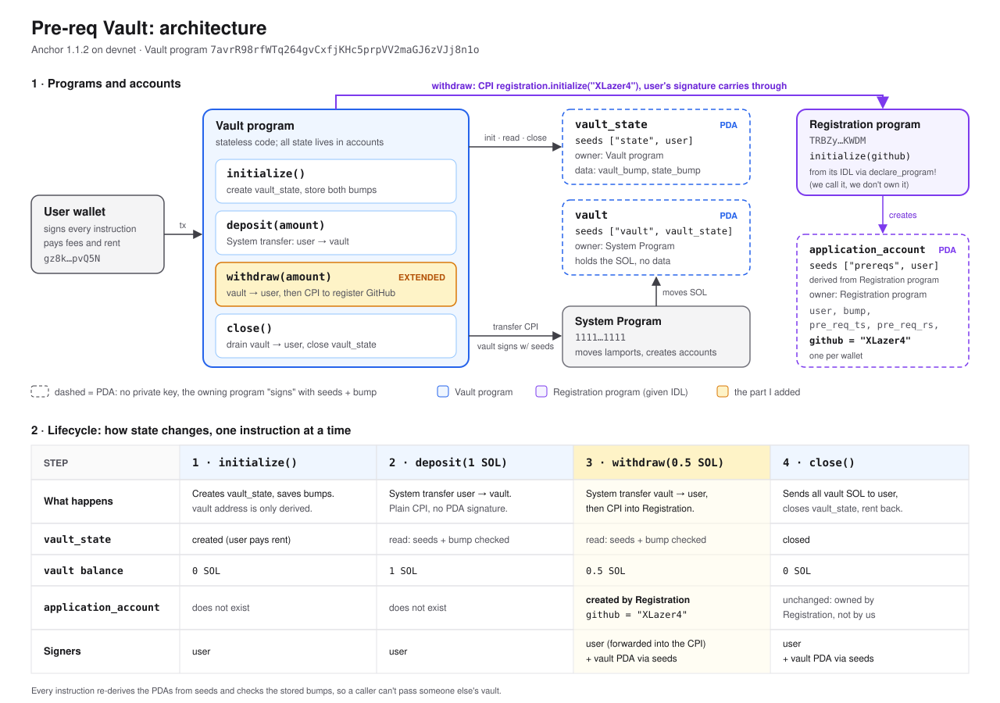

# Turbin3 pre-req: Vault program

My solution to Part 1 of the [Turbin3 Q4 2026 Builders Cohort prerequisite](https://prereq.turbin3.org/#part1): the [pre-req-vault](https://github.com/ShrinathNR/pre-req-vault) Anchor program, with `withdraw` extended to CPI into the Turbin3 registration program and record my GitHub username.

- **Diagram:** [`docs/architecture.svg`](docs/architecture.svg) ([PNG](docs/architecture.png))
- **Video:** https://youtu.be/oJjBEmXePUk



## What the program does

A per-user SOL vault with four instructions:

| Instruction | Accounts it touches | Effect |
| --- | --- | --- |
| `initialize()` | `user`, `vault_state` (init), `vault` | Creates `vault_state` at `["state", user]` and stores the bumps for itself and for `vault` at `["vault", vault_state]`. |
| `deposit(amount)` | `user`, `vault`, `vault_state` | System transfer from `user` to `vault`. |
| `withdraw(amount)` | `user`, `vault`, `vault_state`, `application_account`, `application_program` | System transfer from `vault` to `user`, signed by the vault PDA's seeds, **then a CPI to the registration program's `initialize(github)`**. |
| `close()` | `user`, `vault`, `vault_state` (close) | Moves all vault lamports back to `user` and closes `vault_state`, refunding its rent. |

`vault` is a PDA owned by the System Program. It holds lamports but no data, so moving SOL out of it needs a System Program CPI signed with the vault's seeds. `vault_state` is owned by the Vault program and stores only the two bumps.

## The change

[`programs/pre-req-vault/src/instructions/withdraw.rs`](programs/pre-req-vault/src/instructions/withdraw.rs) already had the registration program's IDL loaded through `declare_program!(registration)`, plus two unused accounts: `application_account` (the PDA `["prereqs", user]` under the registration program) and `application_program`. The extension uses them:

```rust
let cpi_accounts = Initialize {
    user: self.user.to_account_info(),
    account: self.application_account.to_account_info(),
    system_program: self.system_program.to_account_info(),
};

let cpi_ctx = CpiContext::new(self.application_program.key(), cpi_accounts);

initialize(cpi_ctx, "XLazer4".to_string())?;
```

`CpiContext::new` is enough here, with no `new_with_signer`, because the registration program needs `user` as the signer and payer. The user already signed the outer transaction, and Solana carries that signature into the CPI. The vault PDA's seeds are needed only for the System transfer earlier in the same instruction.

## Deployment and verification (devnet)

| | |
| --- | --- |
| Vault program (my deploy) | [`7avrR98rfWTq264gvCxfjKHc5prpVV2maGJ6zVJj8n1o`](https://explorer.solana.com/address/7avrR98rfWTq264gvCxfjKHc5prpVV2maGJ6zVJj8n1o?cluster=devnet) |
| Registration program | [`TRBZyQHB3m68FGeVsqTK39Wm4xejadjVhP5MAZaKWDM`](https://explorer.solana.com/address/TRBZyQHB3m68FGeVsqTK39Wm4xejadjVhP5MAZaKWDM?cluster=devnet) |
| Wallet | [`gz8k5Mq53YZdYGS2gA6iygwxt7vtG82mLRdEv6pvQ5N`](https://explorer.solana.com/address/gz8k5Mq53YZdYGS2gA6iygwxt7vtG82mLRdEv6pvQ5N?cluster=devnet) |
| Registration account | [`7pwf1tYfXuBXTqJGxb1jgP483fVVUY1GpcxzaK9MLikt`](https://explorer.solana.com/address/7pwf1tYfXuBXTqJGxb1jgP483fVVUY1GpcxzaK9MLikt?cluster=devnet): `github = "XLazer4"` |
| Withdraw + CPI tx | [`3X72YEUZ…Z8f5Xt`](https://explorer.solana.com/tx/3X72YEUZXPuN66q46UcLx828bzEtiua9rDUbf4H5upwbY4NXvvJPJkSGdrrZnk96tmmsvmXjq7VLkqqyZvC8f5Xt?cluster=devnet) |

The withdraw transaction's logs show the CPI coming from my program, not from a direct call:

```
Program 7avrR98rfWTq264gvCxfjKHc5prpVV2maGJ6zVJj8n1o invoke [1]
Program log: Instruction: Withdraw
Program 11111111111111111111111111111111 invoke [2]
Program 11111111111111111111111111111111 success
Program TRBZyQHB3m68FGeVsqTK39Wm4xejadjVhP5MAZaKWDM invoke [2]
Program log: Instruction: Initialize
...
Program TRBZyQHB3m68FGeVsqTK39Wm4xejadjVhP5MAZaKWDM success
Program 7avrR98rfWTq264gvCxfjKHc5prpVV2maGJ6zVJj8n1o success
```

`anchor test` output:

```
  pre-req-vault
    ✔ Initialize the vault
    ✔  Deposilt 1 Sol in to the vault
    ✔  Withdraw 0.5 Sol from the vault
    ✔  Close the vault and withdraw all the funds

  4 passing (4s)
```

## Running it

Requires Anchor CLI 1.1.2, Rust, the Solana CLI, and pnpm.

```sh
pnpm install
anchor keys sync          # use your own program keypair
anchor build
anchor deploy --provider.cluster devnet
anchor test --skip-build --skip-deploy --provider.cluster devnet
```

The registration program accepts one registration per wallet, so the withdraw test passes only once per wallet. Running it again fails because `["prereqs", user]` already exists.
